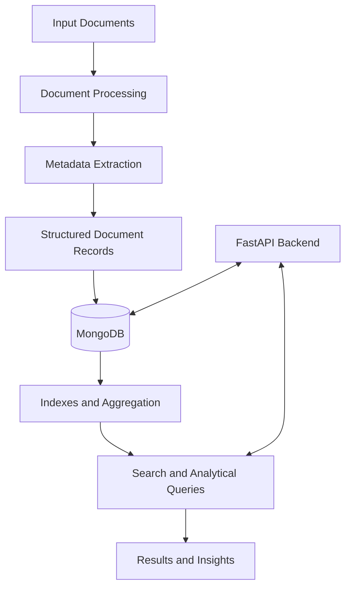

# 🧠 NoSQL Document Intelligence Engine
### Turning unstructured documents into searchable, structured intelligence.

> **From research to implementation:** Exploring how NoSQL databases can support intelligent document processing, flexible data storage, and efficient information retrieval.


---

## 💡 The Idea

Documents contain valuable information, but extracting that information, organizing it, and retrieving it efficiently can be challenging when dealing with large collections of unstructured or semi-structured data.

The **NoSQL Document Intelligence Engine** is a proposed database-driven system designed to explore this problem. It aims to transform documents into structured, searchable records enriched with metadata such as extracted entities and sentiment scores.

Rather than treating documents as isolated text files, the project explores how a document-oriented database can make their contents easier to query, filter, aggregate, and analyze.

**The goal:** Build a practical system that combines document processing, backend development, and NoSQL database engineering.

## 🎯 Project Objectives

- **Structure unstructured information** into records that can be stored and queried efficiently.
- **Explore AI-assisted extraction** of useful metadata, including named entities and sentiment scores.
- **Leverage MongoDB** to represent documents and their extracted information using flexible document schemas.
- **Investigate indexing and aggregation** to support efficient retrieval and analytical queries.
- **Evaluate performance** using measurements such as query latency, insertion time, throughput, and resource consumption.
- **Connect research to implementation** by examining whether the database design performs well for the intended workload.

## 🏗️ Proposed Architecture

The following is the intended high-level workflow. Individual components and their implementation details may evolve during development.



### How it is intended to work

1. **Document ingestion:** Accept documents or text as input.
2. **Processing and extraction:** Identify useful information and generate metadata, including entities and sentiment scores, using an appropriate extraction approach.
3. **Data persistence:** Store document content and extracted metadata in MongoDB.
4. **Query and analysis:** Retrieve relevant records and investigate more complex queries through indexing and aggregation pipelines.
5. **Performance evaluation:** Measure how the system behaves under representative workloads and identify opportunities for optimization.

*This architecture describes the proposed design, not a claim that every component is already implemented.*

## 🛠️ Proposed Technology Stack

| Technology | Intended role |
|---|---|
| **MongoDB** | Document storage, indexing, and aggregation |
| **Python** | Backend logic and document processing |
| **FastAPI** | Backend API and CRUD operations |
| **AI / NLP techniques** | Entity extraction and sentiment analysis |
| **MongoDB Query Language** | Filtering, querying, and aggregation |

The specific AI/NLP libraries, deployment environment, and additional tools will be documented once selected and implemented.

## 🔬 Research Foundation

This project is informed by the research paper reviewed as part of the DBMS academic work.

**Paper:** *Evaluating the Performance of NoSQL Databases for Big Data in Cloud Computing Environments*

**Authors:** Ahmet E. Topcu et al.

**Published in:** *HighTech and Innovation Journal*, Volume 6, Issue 3, 2025, pp. 808–830.

**DOI:** [10.28991/HIJ-2025-06-03-05](https://doi.org/10.28991/HIJ-2025-06-03-05)

The study compares MongoDB and Riak KV across Google Cloud Platform, DigitalOcean, and OpenStack using the Yahoo Cloud Serving Benchmark (YCSB). Its evaluation considers workload-dependent performance, including throughput and latency.

### From paper to project

The research provides a starting point for database selection, but standardized benchmarks do not establish how a database will perform for every application.

This project explores that gap by considering document-oriented workloads, including metadata retrieval and aggregation over extracted information.

The intention is to investigate questions such as:

- How does indexing affect query performance?
- How efficiently can documents and extracted metadata be retrieved?
- How do aggregation pipelines perform on representative document collections?
- What trade-offs arise between query complexity, response time, and resource usage?

**Important distinction:** The paper's results are not assumed to prove that MongoDB is universally optimal. The proposed implementation will provide an opportunity to investigate its suitability for this specific use case.

## 📊 Performance Evaluation Plan

Performance evaluation is a proposed part of the project, with final tests to be determined during implementation.

| Metric | What it helps evaluate |
|---|---|
| Insertion time | Time required to store document records |
| Query latency | Time taken to execute selected queries |
| Throughput | Number of operations completed over a period |
| Indexing impact | Differences between indexed and non-indexed queries |
| Aggregation performance | Execution time for selected analytical pipelines |
| Resource consumption | Computing resources required under tested workloads |

Any reported results will be based on actual experiments, with the dataset, configuration, and test conditions documented alongside the measurements.

## 📁 Repository Structure

The repository is intended to keep the research review, implementation, experiments, and project documentation together.

```text
nosql-document-intelligence-engine/
│
├── README.md
│
├── research/
│   ├── research-paper-review.pdf
│   └── references.md
│
├── docs/
│   ├── architecture.md
│   └── database-design.md
│
├── app/
│   ├── main.py
│   ├── routes/
│   ├── services/
│   └── database/
│
├── scripts/
│   └── seed_database.py
│
├── tests/
│
├── benchmarks/
│
├── requirements.txt
├── .env.example
└── .gitignore
```

*This is a proposed directory layout. Files and folders will be added as the corresponding components are developed.*

## 🚧 Development Roadmap

- [ ] Finalize the problem definition and functional requirements.
- [ ] Design the MongoDB document schema.
- [ ] Set up the Python backend and database connection.
- [ ] Implement document ingestion and CRUD operations.
- [ ] Integrate metadata extraction and sentiment analysis.
- [ ] Develop useful query and aggregation pipelines.
- [ ] Create a representative dataset for testing.
- [ ] Benchmark selected queries and indexing strategies.
- [ ] Document experimental findings, limitations, and future improvements.

Progress will be reflected in the repository as implementation and testing advance.

## 🎓 Academic Context

This repository brings together the research review and the proposed practical implementation for a DBMS academic project at MIT World Peace University, Pune.

It is intended to demonstrate the connection between research-driven technical decisions and hands-on database engineering.

**Contributors:** Medha Tiwari · Viren More

**Department:** Electronics and Communication Engineering

**Academic Year:** 2026–2027

## 🤝 Contributions and Feedback

Suggestions on database design, indexing strategies, query optimization, document-processing workflows, and performance evaluation are welcome.

If you have ideas for improving the proposed architecture or making the benchmark methodology more meaningful, feel free to open an issue or start a discussion.

## 📌 Current Status

This repository is under development. The research review provides the foundation for the project, while the implementation, experiments, and final results will be added progressively.

**The objective is not simply to store documents in a database, but to investigate how document intelligence and NoSQL database capabilities can work together in a measurable, practical system.**

---

*Built as an exploration of NoSQL databases, document intelligence, and research-driven software engineering.*
